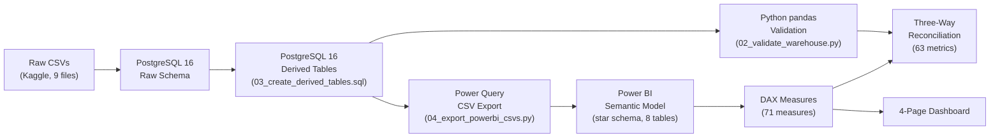
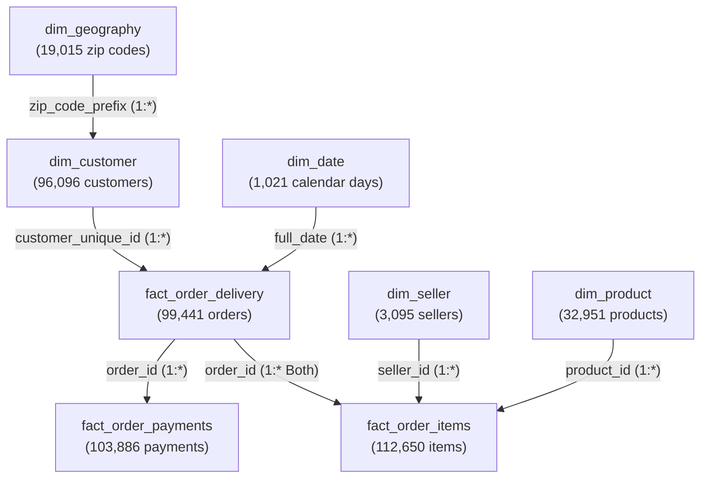
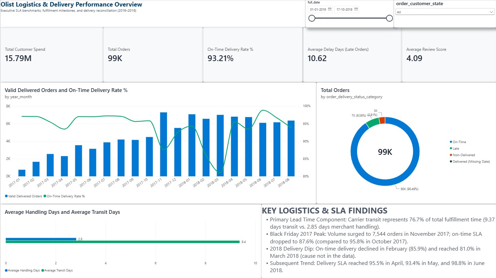
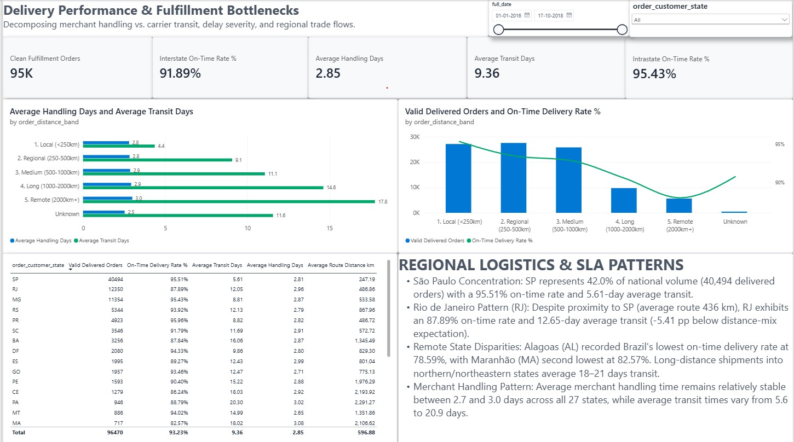
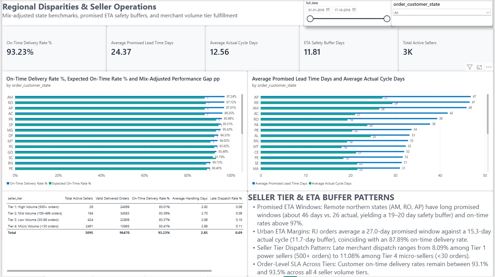
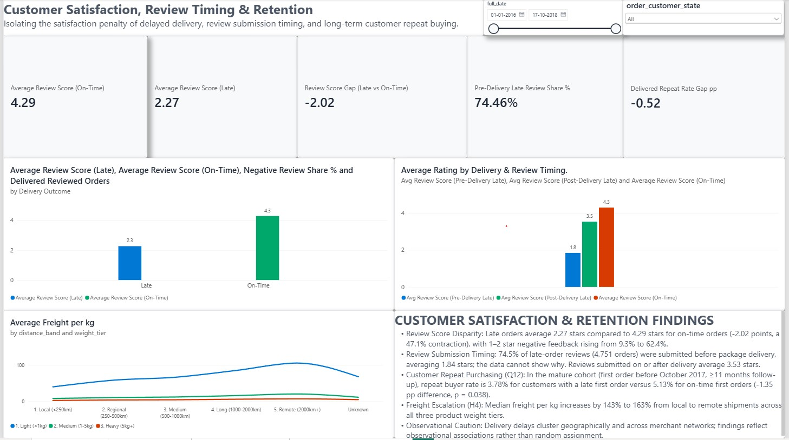

# Olist E-Commerce Delivery Performance & Customer Satisfaction

**Independent portfolio project** — end-to-end analytical data product using the
[Brazilian E-Commerce Public Dataset by Olist](https://www.kaggle.com/datasets/olistbr/brazilian-ecommerce)
(Kaggle, CC BY-NC-SA 4.0).

---

## Table of Contents
1. [Project Overview](#1-project-overview)
2. [Key Findings](#2-key-findings)
3. [Architecture](#3-architecture)
4. [Dashboard Pages](#4-dashboard-pages)
5. [Repository Structure](#5-repository-structure)
6. [How to Reproduce](#6-how-to-reproduce)
7. [Data Sources & Lineage](#7-data-sources--lineage)
8. [Methodology & Limitations](#8-methodology--limitations)
9. [License](#9-license)

---

## 1. Project Overview

This project analyses **99,441 orders** placed on the Olist marketplace between
September 2016 and October 2018, with a focus on four analytical questions:

| Hypothesis | Question |
|---|---|
| **H1 — SLA Penalty** | Do late deliveries drive significantly lower review scores? |
| **H2 — Regional Disparity** | Does on-time performance vary systematically by customer state, beyond what order-mix alone explains? |
| **H3 — ETA Buffer** | Do sellers / Olist inflate promised lead times as a carrier-delay hedge, and does the buffer vary by region? |
| **H4 — Freight Escalation** | Does freight cost per kg rise with shipment distance across weight tiers? |

The pipeline runs from raw CSV ingestion through PostgreSQL 16 warehousing, Python
pandas validation, Power BI semantic modelling, and DAX measure authoring, ending
in a four-page interactive dashboard and a three-way numerical reconciliation across
all three compute layers.

---

## 2. Key Findings

> All figures are observational. The dataset contains no randomised assignment, no
> causal mechanism, and no information on carrier identity, route choice, or
> operational decisions. "Associated with" and "pattern observed" are used
> throughout; "caused by", "proves", and "confirms" are avoided.

### H1 — SLA Penalty ✅ Supported
- On-time orders average **4.29 ★**; late orders average **2.27 ★** — a gap of
  **−2.02 points (−47.1%)**.
- **74.5% of late-order reviews** (4,751 of 6,378) were submitted *before* package
  delivery, averaging **1.84 ★**. Reviews submitted on or after delivery average
  **3.53 ★**, closing most of the gap. The data cannot show why reviews are
  submitted early.
- In a mature cohort (first order placed before October 2017, ≥11-month follow-up):
  customers whose first order was late show a **−1.35 pp lower repeat-buying rate**
  (3.78% vs 5.13%, p = 0.038). The full-cohort gap is −0.52 pp (p = 0.016).

### H2 — Regional Disparity ✅ Supported
- **Alagoas (AL)** records Brazil's lowest on-time rate at **78.59%**
  (−11.68 pp mix-adjusted gap); **Maranhão (MA)** is second lowest at **82.57%**
  (−6.24 pp). **Rio de Janeiro (RJ)** underperforms despite geographic proximity to SP:
  statewide on-time delivery is **87.89%** (12.05 days transit, 486.86 km route;
  −5.41 pp mix-adjusted gap), while the dominant SP → RJ trade corridor averages
  12.65 days transit and 86.38% on-time.
- Average merchant handling time is stable across all 27 states (2.7–3.0 days).
  Average carrier transit time ranges from **5.6 days (Local) to 20.9 days
  (Remote)**, consistent with transit time driving state-level variation.
- **São Paulo (SP)** accounts for 42.0% of national volume (40,494 orders) at
  95.51% on-time, with a +1.07 pp positive mix-adjusted gap.

### H3 — ETA Buffer ✅ Supported
- Across all orders: average **promised lead time 24.37 days** vs **actual cycle
  12.56 days** — an **11.81-day buffer**.
- Remote northern states carry the largest buffers: **Amazonas (AM)** promises
  45.9 days against a 26.4-day actual cycle (buffer ≈ 19.5 days); **Rondônia (RO)**
  similarly. Both states achieve on-time rates above 97%.
- **Rio de Janeiro (RJ)** receives only an **11.7-day buffer** against a
  15.3-day actual cycle, leaving near-zero margin — consistent with its 87.89%
  on-time rate.
- Seller late-dispatch rate scales with volume tier: **Tier 1** (500+ orders)
  8.07%, **Tier 2** (100–499 orders) 9.31%, **Tier 3** (30–99 orders) 9.86%, and
  **Tier 4** (<30 orders) 11.07%. Customer on-time delivery rates remain between
  93.1% and 93.5% across all four tiers, consistent with carrier transit buffers
  absorbing merchant dispatch delays.

### H4 — Freight Escalation ✅ Supported
- Median freight per kg rises **143% to 163%** from Local (<250 km) to Remote
  (2,000+ km) shipments across all three weight tiers (Light <1 kg, Medium 1–5 kg,
  Heavy >5 kg).

---

## 3. Architecture



### Star Schema (Power BI)



> **Bidirectional relationship note:** The `fact_order_delivery ↔ fact_order_items`
> relationship is set to **Both** (bidirectional) so that seller/product slicers
> cross-filter delivery metrics. Exactly 825 clean delivered orders (0.87% of the cohort) contain
> items from sellers in multiple volume tiers — a known trade-off documented in `documentation/data_dictionary.md`.

---

## 4. Dashboard Pages

### Page 1 — Executive Overview


**Key visuals:** Monthly SLA trend combo chart (steady-state window: Jan 2017 –
Oct 2018), 99K-order status donut, handling vs. transit bar.

**Headline numbers:** R\$15.84M customer spend · 99,441 orders · 93.23% on-time ·
10.62-day average delay (late orders) · 4.09 ★ overall review score.

---

### Page 2 — Delivery Performance & Fulfillment Bottlenecks


**Key visuals:** Distance-band handling/transit chart, distance-band SLA combo
chart (Local → Remote → Unknown sorted), state-level performance table with
cross-filtering.

**Headline numbers:** 95,082 clean fulfillment orders (61,022 interstate, 34,060 intrastate) · 91.89% interstate on-time ·
95.43% intrastate on-time · 2.85-day handling · 9.36-day transit.

---

### Page 3 — Regional Disparities & Seller Operations


**Key visuals:** Actual vs. expected SLA horizontal bar (with mix-adjusted gap pp
tooltip), promised ETA vs. actual cycle horizontal bar, seller tier table.

**Headline numbers:** 24.37-day promised lead time · 12.56-day actual cycle ·
11.81-day ETA buffer · 3,095 active sellers.

---

### Page 4 — Customer Satisfaction, Review Timing & Retention


**Key visuals:** Review score by delivery outcome (Late / On-Time), review timing
anatomy (pre-delivery late vs. post-delivery late vs. on-time), freight per kg by
distance band and weight tier.

**Headline numbers:** 4.29 ★ on-time · 2.27 ★ late · −2.02 gap · 74.46%
pre-delivery late reviews · −0.52 pp repeat-buying gap.

---

## 5. Repository Structure

```
02_PowerBI_Olist_Delivery_Analytics/
│
├── README.md                          ← this file
├── Olist_Delivery_Analytics.pbix      ← Power BI Desktop file
├── run_all_sql.ps1                    ← one-shot PostgreSQL setup script
│
├── data/
│   ├── raw/                           ← original Kaggle CSVs (9 files, not committed)
│   └── processed/
│       └── powerbi_input/             ← cleaned CSVs loaded by Power Query
│
├── sql/
│   ├── 00_create_database.sql
│   ├── 01_create_raw_tables.sql
│   ├── 02_load_raw_data.sql
│   ├── 03_create_derived_tables.sql
│   └── queries/                       ← numbered business-query scripts (Q01–Q12)
│
├── python/
│   ├── 01_data_profiling.py
│   ├── 02_validate_warehouse.py
│   ├── 03_run_business_queries.py
│   └── 04_export_powerbi_csvs.py
│
├── powerbi/
│   ├── dax/
│   │   ├── measures.dax               ← 71 DAX measure definitions
│   │   ├── evaluate_all_63_measures.dax
│   │   └── all_measures_dax_query_view.dax
│   ├── power_query/                   ← M query scripts per table
│   ├── specifications/                ← page-level build specifications
│   ├── theme/                         ← Power BI JSON theme file
│   └── README_build_guide.md
│
├── documentation/
│   ├── requirements.md
│   ├── profiling_report.md
│   ├── transformation_log.md
│   ├── business_queries_report.md
│   ├── kpi_dictionary.md
│   ├── three_way_reconciliation_report.md
│   ├── data_dictionary.md             ← Phase 7
│   └── interview_defense_notes.md     ← Phase 7
│
└── screenshots/
    ├── page1_executive_overview.jpg
    ├── page2_delivery_performance.jpg
    ├── page3_regional_and_seller.jpg
    └── page4_customer_satisfaction.jpg
```

---

## 6. How to Reproduce

### Prerequisites
| Tool | Version |
|---|---|
| PostgreSQL | 16 |
| Python | 3.11 |
| Power BI Desktop | June 2024 or later |
| Python packages | `pandas`, `psycopg2`, `sqlalchemy`, `numpy`, `scipy` |

### Steps

**1. Load raw data into PostgreSQL**
```powershell
# Edit connection string in run_all_sql.ps1 first
.\run_all_sql.ps1
```

**2. Validate the warehouse**
```powershell
python python/02_validate_warehouse.py
```

**3. Export Power BI input CSVs**
```powershell
python python/04_export_powerbi_csvs.py
```

**4. Open Power BI Desktop**
- Open `Olist_Delivery_Analytics.pbix`
- Go to **Transform data → Manage parameters** → set `SourceFolder` to your
  local `data/processed/powerbi_input/` path
- Click **Refresh**

**5. Verify measures (optional)**
- Open **DAX Query View** in Power BI Desktop
- Paste contents of `powerbi/dax/evaluate_all_63_measures.dax`
- Run — all scalar measures should match the control totals in
  `documentation/three_way_reconciliation_report.md`

---

## 7. Data Sources & Lineage

| Layer | Tool | Key output |
|---|---|---|
| Raw ingestion | PostgreSQL 16 | `raw.*` schema, 9 tables |
| Derived warehouse | PostgreSQL 16 | `public.fact_order_delivery`, `dim_*` tables |
| Pandas validation | Python 3.11 | Control-total CSVs, profiling report |
| Power BI input | Python export | 8 CSV tables in `data/processed/powerbi_input/` |
| Semantic model | Power BI / DAX | 8 tables, 71 measures |
| Reconciliation | Python + DAX | 63 metrics verified across all three layers |

**Dataset:** Olist Brazilian E-Commerce Public Dataset  
**Source:** https://www.kaggle.com/datasets/olistbr/brazilian-ecommerce  
**License:** CC BY-NC-SA 4.0 — non-commercial use, attribution required  
**Date range:** 2016-09-04 to 2018-10-17 (dataset maximum; `TODAY()` is never used)

---

## 8. Methodology & Limitations

### Cohort Definitions
- **Valid delivered cohort (96,470 orders):** `order_status = 'delivered'` with
  non-null actual and estimated delivery timestamps. Excludes cancelled, unavailable,
  and in-transit orders.
- **Clean fulfillment cohort (95,082 orders):** further excludes 1,388 orders with
  missing carrier pickup timestamps (handling days cannot be computed).
- **Steady-state window (Page 1):** January 2017 – October 2018, flagged by
  `is_steady_state_window = TRUE`, excluding the sparse 2016 ramp-up period
  (Sep–Dec 2016: 4 orders total at 0% on-time).
- **Mature repeat-buying cohort:** customers whose first order was placed before
  October 2017, allowing ≥11 months of follow-up observation within the dataset.

### Known Limitations
1. **No causal identification.** The dataset contains no randomised assignment.
   Regional performance gaps are consistent with transit-time variation but other
   confounders (product category mix, seller density, carrier routing) are not
   controlled for.
2. **Bidirectional relationship trade-off.** The `fact_order_delivery ↔
   fact_order_items` bidirectional relationship allows seller slicers to filter
   delivery metrics, but 825 multi-seller orders (0.83%) can be attributed to more
   than one seller tier simultaneously when slicing order counts by tier.
3. **No carrier or route data.** Transit-time variation is observable but its
   drivers (carrier identity, routing, weather) are absent from the dataset.
4. **Review timing ambiguity.** 74.5% of late-order reviews were submitted before
   confirmed delivery. The data cannot explain whether customers reviewed early due
   to frustration, app prompts, or other reasons.
5. **Dataset terminates at 2018-10-17.** Trends beyond this date are not observable.
   The date table is bounded at the dataset maximum; `TODAY()` is not used anywhere.

---

## 9. License

**Data:** CC BY-NC-SA 4.0 — Olist Brazilian E-Commerce Public Dataset (Kaggle).  
**Code and analysis:** MIT License — free to use with attribution for non-commercial purposes.

---

*Last updated: November 2026*
