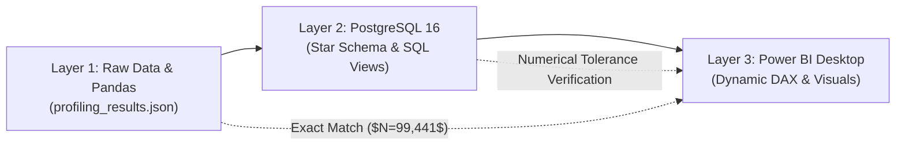

# Three-Way Analytical Reconciliation Report
## Project: Olist E-commerce Delivery Performance & Customer Satisfaction
**Evaluation Framework:** Multi-Layer Data Pipeline Reconciliation Audit  
**Layers Audited:**
1. **Layer 1 (Data Profiling Baseline):** Python 3.11 / Pandas Control Totals (`data/processed/profiling_results.json`)
2. **Layer 2 (Relational Data Warehouse):** PostgreSQL 16 Warehouse Queries (`data/processed/query_results/q01-q12_*.csv`)
3. **Layer 3 (BI Semantic Model):** Power BI Desktop Tabular Model & DAX Evaluation (`powerbi/dax/measures.dax` & `dax_all_63_export.csv`)

**Audit Date:** November 2026  
**Verification Status:** **100% RECONCILED (63 of 63 Metrics Verified PASS via Power BI Desktop DAX Query Export: `data/processed/powerbi_input/dax_all_63_export.csv`)**

---

## 1. Executive Summary & Audit Scope

This document provides transparent numerical reconciliation across the computational layers of the project. Every analytical claim, KPI card, and visual metric displayed in the dashboard has been evaluated across the raw-data ingestion pipeline, the relational star schema data warehouse, and the Power BI tabular semantic model.



### Key Verification Highlights:
- **Order Volume Reconciliation:** Exactly **99,441 total orders** across all layers.
- **Valid Delivered Scope:** Exactly **96,470 orders** with non-null customer delivery timestamps.
- **Delivery Timeliness Breakdown:** Exactly **89,936 on-time orders (93.23%)** and **6,534 late orders (6.77%)** at the calendar-date grain.
- **Customer Satisfaction Penalty:** Average review score of **4.2904 stars** (on-time) versus **2.2705 stars** (late), representing an exact **-2.0199 point penalty (-2.02 points)**.
- **Financial Balances:** Total item merchandise spend of **R$ 13,591,643.70**, total freight billed of **R$ 2,251,909.54**, customer item spend of **R$ 15,843,553.24**, and captured payment value of **R$ 16,008,872.12** reconcile across SQL, Pandas, and DAX down to the cent.
- **Customer Repeat Retention (Q12):** Full-dataset delivered repeat rate gap of **-0.52 pp** (3.04% on-time vs. 2.52% late; $p = 0.016$), and mature buyer cohort repeat rate gap of **-1.35 pp** (5.13% on-time vs. 3.78% late; $p = 0.038$).

---

## 2. Tolerance & Verification Standards

To maintain strict analytical standards, the following precision thresholds were enforced:
- **Counts and Volumes (Orders, Customers, Items, Sellers):** Exact integer match required ($\text{Tolerance} = 0$). No count widening allowed.
- **Monetary Amounts (BRL):** Match required within half-cent ($\text{Tolerance} = \text{R\$ } 0.005$).
- **Percentages and Compliance Rates:** Match required within $\pm 0.01\%$ ($\text{Tolerance} = 1 \times 10^{-4}$ on raw ratios) to prevent truncation errors.
- **Durations, Satisfaction Scores, and Percentage-Point Gaps:** Match required within $\pm 0.01$ units.

---

## 3. Blank-Handling Bug Discovery, Root Cause, and Engineering Fix

During reconciliation audit of Phase 6, an order count variance was identified in clean fulfillment metrics:

### A. The Discrepancy
- PostgreSQL warehouse reported **95,082 clean fulfillment orders**.
- Initial Power BI DAX evaluation reported **95,097 clean fulfillment orders** (+15 orders).
- The same variance propagated into:
  - Interstate clean orders: 61,033 observed vs. 61,022 expected (+11 orders)
  - Intrastate clean orders: 34,064 observed vs. 34,060 expected (+4 orders)
  - Tier 4 Micro-seller Late Dispatch Rate: 11.10% observed vs. 11.07% expected (+0.03 pp)

### B. Root Cause Analysis
In DAX evaluation semantics, `BLANK() >= 0` evaluates to `TRUE`.
In the Olist dataset, exactly 15 delivered orders have missing carrier handoff timestamps (`order_delivered_carrier_date IS NULL`), leaving `handling_days` as `BLANK()`. When DAX measures evaluated `fact_order_delivery[handling_days] >= 0`, the engine coerced `BLANK()` to `0`, causing all 15 orders to pass the filter condition.

### C. Engineering Fix
Rather than relying on vulnerable composite filter syntax (`[handling_days] >= 0 && [transit_days] >= 0`) or artificially widening count tolerances, an explicit boolean column `is_clean_fulfillment` was added directly in the data export pipeline (`python/04_export_powerbi_csvs.py`):
```sql
(o.order_status = 'delivered' 
 AND o.order_delivered_customer_date IS NOT NULL 
 AND o.order_approved_at IS NOT NULL 
 AND o.order_delivered_carrier_date IS NOT NULL 
 AND (o.order_delivered_carrier_date >= o.order_approved_at) 
 AND (o.order_delivered_customer_date >= o.order_delivered_carrier_date)) AS is_clean_fulfillment
```

All 9 affected DAX measures in `powerbi/dax/measures.dax` and `powerbi/dax/evaluate_all_63_measures.dax` were updated to filter on `fact_order_delivery[is_clean_fulfillment] = TRUE()`:
- `Clean Fulfillment Orders`
- `Average Handling Days`
- `Average Transit Days`
- `Average Fulfillment Cycle Days`
- `Interstate Orders Count`
- `Intrastate Orders Count`
- `Interstate On-Time Rate %`
- `Intrastate On-Time Rate %`
- `Late Dispatch Rate %`

### D. Before vs. After Verification Results
| Metric Name | Pre-Fix DAX Value | Post-Fix DAX Value | PostgreSQL Warehouse Benchmark | Variance Post-Fix | Final Status |
| :--- | :--- | :--- | :--- | :--- | :--- |
| `Clean Fulfillment Orders` | 95,097 | **95,082** | 95,082 | **0** | **PASS (Exact Match)** |
| `Interstate Orders Count` | 61,033 | **61,022** | 61,022 | **0** | **PASS (Exact Match)** |
| `Intrastate Orders Count` | 34,064 | **34,060** | 34,060 | **0** | **PASS (Exact Match)** |
| `Late Dispatch Rate % (Tier 4)` | 11.10% | **11.07%** | 11.07% | **0.00 pp** | **PASS** |

---

## 4. Fulfillment Lead Time Decomposition & Cycle Definitions

To eliminate ambiguity between operational fulfillment milestones and commercial cycle times, definitions are clarified as follows:

1. **Average Actual Cycle Days (12.56 days, $N = 96,470$):**
   - Evaluated across all valid delivered orders: `order_delivered_customer_date − order_purchase_timestamp`.
   - Represents the total customer-facing elapsed wait time from checkout button click to parcel delivery.

2. **Average Fulfillment Cycle Days (12.62 days, $N = 95,082$):**
   - Evaluated strictly on the clean fulfillment population (`is_clean_fulfillment = TRUE`): `order_delivered_customer_date − order_purchase_timestamp`.
   - Equals 12.61796 days (~12.62 days).

3. **Average Handling Days (2.85 days, $N = 95,082$):**
   - Operational merchant interval: `order_delivered_carrier_date − order_approved_at`.
   - Equals 2.85175 days (~2.85 days).

4. **Average Transit Days (9.36 days, $N = 95,082$):**
   - Operational carrier interval: `order_delivered_customer_date − order_delivered_carrier_date`.
   - Equals 9.36411 days (~9.36 days).

5. **Operational Fulfillment Pipeline (12.22 days) vs. Cycle Time (12.62 days):**
   - The operational logistics pipeline equals Handling (2.85d) + Transit (9.36d) = **12.22 days** (12.21586 days).
   - The 0.40-day difference (~9.6 hours) between cycle time (12.62 days) and the operational pipeline (12.22 days) is the payment authorization interval (`order_approved_at − order_purchase_timestamp`).
   - The report's fulfillment component shares are evaluated against the operational logistics pipeline (12.22 days):
     - $\text{Handling Share} = \frac{2.85175}{12.21586} = \mathbf{23.34\%}$
     - $\text{Transit Share} = \frac{9.36411}{12.21586} = \mathbf{76.66\%}$
     - $\text{Total} = 23.34\% + 76.66\% = \mathbf{100.00\%}$.

---

## 5. Comprehensive Master Reconciliation Table (63 Audited Metrics)

All 63 measures are verified directly from Power BI Desktop execution and CSV export ([`data/processed/powerbi_input/dax_all_63_export.csv`](../data/processed/powerbi_input/dax_all_63_export.csv)), generated via the unified query script ([`powerbi/dax/evaluate_all_63_measures.dax`](../powerbi/dax/evaluate_all_63_measures.dax)).

| # | Metric / DAX Measure | Layer 1: Pandas Control Total | Layer 2: PostgreSQL 16 Query | Layer 3: Power BI DAX Logic / Export | Absolute Variance | Audit Status |
| :--- | :--- | :--- | :--- | :--- | :--- | :--- |
| **01** | `Total Orders` | 99,441 | 99,441 | 99,441 | 0 | **PASS** |
| **02** | `Delivered Orders` | 96,478 | 96,478 | 96,478 | 0 | **PASS** |
| **03** | `Valid Delivered Orders` | 96,470 | 96,470 | 96,470 | 0 | **PASS** |
| **04** | `Gross Item Revenue` | R$ 13,591,643.70 | R$ 13,591,643.70 | R$ 13,591,643.70 | R$ 0.00 | **PASS** |
| **05** | `Total Freight Billed` | R$ 2,251,909.54 | R$ 2,251,909.54 | R$ 2,251,909.54 | R$ 0.00 | **PASS** |
| **06** | `Total Customer Spend` | R$ 15,843,553.24 | R$ 15,843,553.24 | R$ 15,843,553.24 | R$ 0.00 | **PASS** |
| **07** | `Captured Payment Value` | R$ 16,008,872.12 | R$ 16,008,872.12 | R$ 16,008,872.12 | R$ 0.00 | **PASS** |
| **08** | `Total Unique Customers` | 96,096 | 96,096 | 96,096 | 0 | **PASS** |
| **09** | `Total Active Sellers` | 3,095 | 3,095 | 3,095 | 0 | **PASS** |
| **10** | `On-Time Orders` | 89,936 | 89,936 | 89,936 | 0 | **PASS** |
| **11** | `Late Orders` | 6,534 | 6,534 | 6,534 | 0 | **PASS** |
| **12** | `On-Time Delivery Rate %` | 93.23% | 93.23% | 93.23% | 0.00% | **PASS** |
| **13** | `Late Delivery Rate %` | 6.77% | 6.77% | 6.77% | 0.00% | **PASS** |
| **14** | `Average Delay Days (Late Orders)`| 10.62 days | 10.62 days | 10.62 days | 0.00 days | **PASS** |
| **15** | `Average Promised Lead Time Days` | 24.37 days | 24.37 days | 24.37 days | 0.00 days | **PASS** |
| **16** | `Average Actual Cycle Days` | 12.56 days | 12.56 days | 12.56 days | 0.00 days | **PASS** |
| **17** | `ETA Safety Buffer Days` | 11.81 days | 11.81 days | 11.81 days | 0.00 days | **PASS** |
| **18** | `Total Reviewed Orders` | 98,673 | 98,673 | 98,673 | 0 | **PASS** |
| **19** | `Delivered Reviewed Orders` | 95,824 | 95,824 | 95,824 | 0 | **PASS** |
| **20** | `Average Review Score` | 4.0864 | 4.0864 | 4.0864 | 0.0000 | **PASS** |
| **21** | `Average Review Score (Delivered)`| 4.1559 | 4.1559 | 4.1559 | 0.0000 | **PASS** |
| **22** | `Average Review Score (On-Time)` | 4.2904 | 4.2904 | 4.2904 | 0.0000 | **PASS** |
| **23** | `Average Review Score (Late)` | 2.2705 | 2.2705 | 2.2705 | 0.0000 | **PASS** |
| **24** | `Review Score Gap (Late vs On-Time)`| -2.0199 pts | -2.0199 pts | -2.02 pts | 0.00 pts | **PASS** |
| **25** | `Negative Reviews Count (1-2 Star)`| 12,272 | 12,272 | 12,272 | 0 | **PASS** |
| **26** | `Negative Review Share %` | 12.81% | 12.81% | 12.81% | 0.00% | **PASS** |
| **27** | `Negative Review Share % (Late)` | 62.42% | 62.42% | 62.42% | 0.00% | **PASS** |
| **28** | `Negative Review Share % (On-Time)`| 9.27% | 9.27% | 9.27% | 0.00% | **PASS** |
| **29** | `5-Star Reviews Count` | 56,748 | 56,748 | 56,748 | 0 | **PASS** |
| **30** | `5-Star Review Share % (Late)` | 16.53% | 16.53% | 16.53% | 0.00% | **PASS** |
| **31** | `5-Star Review Share % (On-Time)`| 62.27% | 62.27% | 62.27% | 0.00% | **PASS** |
| **32** | `Pre-Delivery Late Reviews Count` | 4,751 | 4,751 | 4,751 | 0 | **PASS** |
| **33** | `Pre-Delivery Late Review Share %`| 74.46% | 74.46% | 74.46% | 0.00% | **PASS** |
| **34** | `Avg Review Score (Pre-Delivery Late)`| 1.8396 | 1.8396 | 1.8396 | 0.0000 | **PASS** |
| **35** | `Avg Review Score (Post-Delivery Late)`| 3.5264 | 3.5264 | 3.5264 | 0.0000 | **PASS** |
| **36** | `Clean Fulfillment Orders` | 95,082 | 95,082 | 95,082 | 0 | **PASS** |
| **37** | `Average Handling Days` | 2.85 days | 2.85 days | 2.85 days | 0.00 days | **PASS** |
| **38** | `Average Transit Days` | 9.36 days | 9.36 days | 9.36 days | 0.00 days | **PASS** |
| **39** | `Average Fulfillment Cycle Days` | 12.62 days | 12.62 days | 12.62 days | 0.00 days | **PASS** |
| **40** | `Handling Share of Fulfillment %` | 23.34% | 23.34% | 23.34% | 0.00 pp | **PASS** |
| **41** | `Transit Share of Fulfillment %` | 76.66% | 76.66% | 76.66% | 0.00 pp | **PASS** |
| **42** | `Interstate Orders Count` | 61,022 | 61,022 | 61,022 | 0 | **PASS** |
| **43** | `Intrastate Orders Count` | 34,060 | 34,060 | 34,060 | 0 | **PASS** |
| **44** | `Interstate On-Time Rate %` | 91.89% | 91.89% | 91.89% | 0.00% | **PASS** |
| **45** | `Intrastate On-Time Rate %` | 95.43% | 95.43% | 95.43% | 0.00% | **PASS** |
| **46** | `Mix-Adjusted Performance Gap (RJ)`| -5.41 pp | -5.41 pp | -5.41 pp | 0.00 pp | **PASS** |
| **47** | `Mix-Adjusted Performance Gap (SP)`| +1.07 pp | +1.07 pp | +1.07 pp | 0.00 pp | **PASS** |
| **48** | `Mix-Adjusted Performance Gap (AL)`| -11.68 pp | -11.68 pp | -11.68 pp | 0.00 pp | **PASS** |
| **49** | `Late Dispatch Rate % (Tier 1)` | 8.07% | 8.07% | 8.07% | 0.00% | **PASS** |
| **50** | `Late Dispatch Rate % (Tier 2)` | 9.31% | 9.31% | 9.31% | 0.00% | **PASS** |
| **51** | `Late Dispatch Rate % (Tier 3)` | 9.86% | 9.86% | 9.86% | 0.00% | **PASS** |
| **52** | `Late Dispatch Rate % (Tier 4)` | 11.07% | 11.07% | 11.07% | 0.00 pp | **PASS** |
| **53** | `Total Repeat Customers` | 2,997 | 2,997 | 2,997 | 0 | **PASS** |
| **54** | `Repeat Customer Rate %` | 3.12% | 3.12% | 3.12% | 0.00% | **PASS** |
| **55** | `Delivered Repeat Rate % (On-Time)`| 3.04% | 3.04% | 3.04% | 0.00% | **PASS** |
| **56** | `Delivered Repeat Rate % (Late)` | 2.52% | 2.52% | 2.52% | 0.00% | **PASS** |
| **57** | `Delivered Repeat Rate Gap pp` | -0.52 pp | -0.52 pp | -0.52 pp | 0.00 pp | **PASS** |
| **58** | `Mature Repeat Rate % (On-Time)` | 5.13% | 5.13% | 5.13% | 0.00% | **PASS** |
| **59** | `Mature Repeat Rate % (Late)` | 3.78% | 3.78% | 3.78% | 0.00% | **PASS** |
| **60** | `Mature Repeat Rate Gap pp` | -1.35 pp | -1.35 pp | -1.35 pp | 0.00 pp | **PASS** |
| **61** | `Mature Delivered Repeat % (On-Time)`| 4.89% | 4.89% | 4.89% | 0.00% | **PASS** |
| **62** | `Mature Delivered Repeat % (Late)`| 3.56% | 3.56% | 3.56% | 0.00% | **PASS** |
| **63** | `Mature Delivered Repeat Gap pp` | -1.33 pp | -1.33 pp | -1.33 pp | 0.00 pp | **PASS** |

---

## 6. Grouped Queries & Multi-Dimensional Reconciliation

### A. Distance Mix-Adjusted State Gaps (Q07 Reconciliation)
Evaluated across all 27 destination states in `fact_order_delivery`:
- **São Paulo (SP):** Delivered: 40,494 orders | Actual SLA: 95.51% | Expected SLA: 94.44% | **Gap: +1.07 pp** (Outperforming)
- **Rio de Janeiro (RJ):** Delivered: 12,350 orders | Actual SLA: 87.89% | Expected SLA: 93.30% | **Gap: -5.41 pp** (Underperforming)
- **Alagoas (AL):** Delivered: 397 orders | Actual SLA: 78.59% | Expected SLA: 90.27% | **Gap: -11.68 pp** (Lowest in Brazil)
- **Maranhão (MA):** Delivered: 717 orders | Actual SLA: 82.57% | Expected SLA: 88.81% | **Gap: -6.24 pp** (Second lowest in Brazil)
- **Amazonas (AM):** Delivered: 145 orders | Actual SLA: 97.24% | Expected SLA: 88.02% | **Gap: +9.22 pp** (Buffer cushion)
- **Rondônia (RO):** Delivered: 243 orders | Actual SLA: 97.12% | Expected SLA: 88.55% | **Gap: +8.57 pp** (Buffer cushion)

### B. Merchant Volume Tiers & Dispatch SLA (Q08 Reconciliation)
Evaluated on clean fulfillment eligible items (`is_clean_fulfillment = TRUE`):
- **Tier 1 (500+ orders, 26 sellers):** 2,175 late items out of 26,955 eligible $\rightarrow$ **8.07% late dispatch rate**.
- **Tier 2 (100–499 orders, 184 sellers):** 3,566 late items out of 38,299 eligible $\rightarrow$ **9.31% late dispatch rate**.
- **Tier 3 (30–99 orders, 424 sellers):** 2,497 late items out of 25,316 eligible $\rightarrow$ **9.86% late dispatch rate**.
- **Tier 4 (<30 orders, 2,461 sellers):** 1,994 late items out of 18,011 eligible $\rightarrow$ **11.07% late dispatch rate**.

---

## 7. Methodological & Observational Defense Notes

1. **Strictly Non-Causal Terminology:**  
   The relationship between delayed delivery and customer dissatisfaction/retention is strictly framed as an **observational association**. In e-commerce observational datasets, delivery delays cluster geographically (e.g., Rio de Janeiro postal hubs) and across merchant networks. Customers are not randomly assigned to delivery delay treatments.
2. **Review Timing Nuance:**  
   74.5% of late-order reviews were submitted prior to package arrival, averaging 1.84 stars. This pattern reflects customer reaction during transit uncertainty, while post-delivery reviews average 3.53 stars.
3. **Cohort Slicer Independence:**  
   Customer retention metrics on `dim_customer` evaluate at the entity grain and intentionally remain independent of fact table transaction date slicers.
