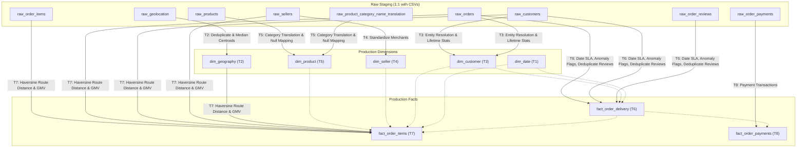

# Data Transformation Log & ETL Specifications
## Project: Olist E-commerce Delivery Performance & Customer Satisfaction
**Version:** 1.0.0  
**Date:** 2026-11-14  

---

### Overview of Transformations

The analytical data warehouse follows an ELT architecture: raw CSV files are loaded unchanged into staging tables (`raw_*`), and production dimensional star schema tables (`dim_*`, `fact_*`) are generated via idempotent SQL transformation scripts (`sql/03_create_derived_tables.sql`). In accordance with non-negotiable rules, no rows are silently deleted; anomalies are flagged as dedicated boolean columns.

---

### Detailed Transformation Catalog

#### T1: Date Dimension Generation (`dim_date`)
- **Target Table:** `dim_date`
- **Source:** Generated via `generate_series('2016-01-01'::date, '2018-12-31'::date, '1 day'::interval)`
- **Grain:** Calendar Day (`full_date`)
- **Row Count:** 1,096 rows
- **Logic:**
  - `date_key`: Integer YYYYMMDD (`TO_CHAR(d, 'YYYYMMDD')::INTEGER`).
  - Standard calendar attributes: `year_num`, `quarter_num`, `quarter_name`, `month_num`, `month_name`, `year_month`, `week_of_year`, `day_of_month`, `day_of_week` (1 = Monday, 7 = Sunday), `day_name`, `is_weekend`.
- **Quality Control:** Ensures unbroken contiguous timeline for Power BI time intelligence DAX functions without date gaps.

#### T2: Geolocation Centroid Deduplication (`dim_geography`)
- **Target Table:** `dim_geography`
- **Source:** `raw_geolocation`
- **Grain:** 5-Digit Postal Prefix (`zip_code_prefix`)
- **Row Count:** 19,015 rows (from 1,000,163 raw rows)
- **Logic:**
  - `median_lat`: `PERCENTILE_CONT(0.5) WITHIN GROUP (ORDER BY geolocation_lat)`
  - `median_lng`: `PERCENTILE_CONT(0.5) WITHIN GROUP (ORDER BY geolocation_lng)`
  - `primary_city` / `primary_state`: Mode city and state per zip prefix (selected via `ROW_NUMBER() OVER (PARTITION BY prefix ORDER BY count DESC)`).
- **Edge Case Handling:**
  - 157 customer zip prefixes (278 orders) and 7 seller zip prefixes (7 sellers) are absent from raw geolocation data. When computing distances in T7, missing prefixes yield `NULL` for `route_distance_km` without dropping order items.

#### T3: Customer Entity Resolution (`dim_customer`)
- **Target Table:** `dim_customer`
- **Source:** `raw_customers`, `raw_orders`
- **Grain:** Customer Unique Entity (`customer_unique_id`)
- **Row Count:** 96,096 rows (from 99,441 transactional `customer_id` rows)
- **Logic:**
  - `primary_city`, `primary_state`, `primary_zip_code_prefix`: Residence attributes from the customer's most recent order.
  - `first_order_timestamp`: `MIN(order_purchase_timestamp)`
  - `last_order_timestamp`: `MAX(order_purchase_timestamp)`
  - `lifetime_orders`: `COUNT(DISTINCT order_id)`
  - `is_repeat_customer`: `CASE WHEN lifetime_orders >= 2 THEN TRUE ELSE FALSE END`
- **Control Benchmark:** Exactly 2,997 repeat customers (3.1188% repeat customer rate).

#### T4: Merchant Dimension Standardization (`dim_seller`)
- **Target Table:** `dim_seller`
- **Source:** `raw_sellers`
- **Grain:** Seller (`seller_id`)
- **Row Count:** 3,095 rows
- **Logic:** Direct 1:1 pass-through with verified primary key integrity.

#### T5: Product Category Translation & Null Mapping (`dim_product`)
- **Target Table:** `dim_product`
- **Source:** `raw_products` LEFT JOIN `raw_product_category_name_translation`
- **Grain:** Product (`product_id`)
- **Row Count:** 32,951 rows
- **Logic:**
  - 610 products with null Portuguese category are mapped to `'uncategorized'` for both Portuguese and English category columns.
  - 2 untranslated categories mapped explicitly:
    - `pc_gamer` $\to$ `'pc_gamer'` (3 products, 9 items)
    - `portateis_cozinha_e_preparadores_de_alimentos` $\to$ `'kitchen_small_appliances'` (10 products, 15 items)
  - All remaining 71 categories translated via standard lookup table.

#### T6: Order Delivery Fact & Review Deduplication (`fact_order_delivery`)
- **Target Table:** `fact_order_delivery`
- **Source:** `raw_orders`, `raw_customers`, `raw_order_reviews`
- **Grain:** Order (`order_id`)
- **Row Count:** 99,441 rows
- **Delivery SLA Logic (Date-Level):**
  - `is_delivered`: `order_status = 'delivered'` (96,478 orders)
  - `is_valid_delivery_date`: `order_delivered_customer_date IS NOT NULL` (96,470 delivered orders; 8 delivered orders have null date)
  - `is_on_time`: `order_delivered_customer_date::DATE <= order_estimated_delivery_date::DATE` (89,936 orders, 93.23% of valid delivered)
  - `is_late`: `order_delivered_customer_date::DATE > order_estimated_delivery_date::DATE` (6,534 orders, 6.77% of valid delivered)
  - `delay_days`: Whole calendar days `order_delivered_customer_date::DATE - order_estimated_delivery_date::DATE` when late, else 0.
  - `estimate_variance_days`: `order_estimated_delivery_date::DATE - order_delivered_customer_date::DATE`
- **Lead Time Durations (Fractional Days):**
  - `handling_days`: `EXTRACT(EPOCH FROM (carrier_date - approved_at)) / 86400.0`
  - `transit_days`: `EXTRACT(EPOCH FROM (delivered_date - carrier_date)) / 86400.0`
  - `cycle_days`: `EXTRACT(EPOCH FROM (delivered_date - purchase_timestamp)) / 86400.0`
- **Non-Destructive Anomaly Flags:**
  - `carrier_before_purchase`: Boolean (166 rows)
  - `carrier_before_approved`: Boolean (1,359 rows across all orders; 1,350 among delivered)
  - `delivery_before_purchase`: Boolean (0 rows)
  - `delivery_before_carrier`: Boolean (23 rows)
  - `delivery_before_approved`: Boolean (61 rows)
  - `has_negative_handling`: Boolean (`carrier_date < approved_at`)
  - `has_negative_transit`: Boolean (`delivered_date < carrier_date`)
  - `is_anomalous_sequence`: Boolean (OR of chronological violations)
  - `is_steady_state_window`: Boolean (`purchase_timestamp` between 2017-01-01 and 2018-08-31; 99,092 orders)
- **Review Deduplication Logic:**
  - 99,224 raw reviews deduplicated to 98,673 unique orders using latest `review_answer_timestamp` (tie-breaker: latest `review_creation_date`, max `review_id`).
  - `review_created_before_delivery`: Boolean (`review_creation_date::DATE < order_delivered_customer_date::DATE`). Flags 4,751 late delivered reviews (74.46% of late reviews) and 225 on-time reviews.

#### T7: Fact Order Items & Haversine Route Distance (`fact_order_items`)
- **Target Table:** `fact_order_items`
- **Source:** `raw_order_items`, `raw_orders`, `raw_customers`, `raw_sellers`, `dim_geography`
- **Grain:** Order Item (`order_id, order_item_id`)
- **Row Count:** 112,650 rows
- **Logic:**
  - `total_item_spend`: `price + freight_value`
  - `freight_to_price_ratio`: `freight_value / NULLIF(price, 0)`
  - `is_interstate`: `customer_state <> seller_state`
  - `route_distance_km`: Haversine great-circle distance computed from customer and seller median coordinates ($R = 6,371 \text{ km}$):
    $$d = 2R \arcsin \left( \sqrt{\sin^2\left(\frac{\Delta \phi}{2}\right) + \cos(\phi_1)\cos(\phi_2)\sin^2\left(\frac{\Delta \lambda}{2}\right)} \right)$$

#### T8: Fact Order Payments (`fact_order_payments`)
- **Target Table:** `fact_order_payments`
- **Source:** `raw_order_payments`
- **Grain:** Payment Transaction (`order_id, payment_sequential`)
- **Row Count:** 103,886 rows
- **Logic:** Preserved at payment grain with foreign key linking to `fact_order_delivery`.

---

### Audit & Control Matrix

| Table Name | Grain | Primary Key | Total Rows | Expected Foreign Key Violations |
| :--- | :--- | :--- | :--- | :--- |
| `dim_date` | Calendar Day | `full_date` | 1,096 | 0 |
| `dim_geography` | Postal Prefix | `zip_code_prefix` | 19,015 | 0 |
| `dim_customer` | Customer Entity | `customer_unique_id` | 96,096 | 0 |
| `dim_seller` | Merchant | `seller_id` | 3,095 | 0 |
| `dim_product` | Product | `product_id` | 32,951 | 0 |
| `fact_order_delivery` | Order | `order_id` | 99,441 | 0 |
| `fact_order_items` | Order Item | `(order_id, order_item_id)` | 112,650 | 0 |
| `fact_order_payments` | Payment Transaction | `(order_id, payment_sequential)` | 103,886 | 0 |
